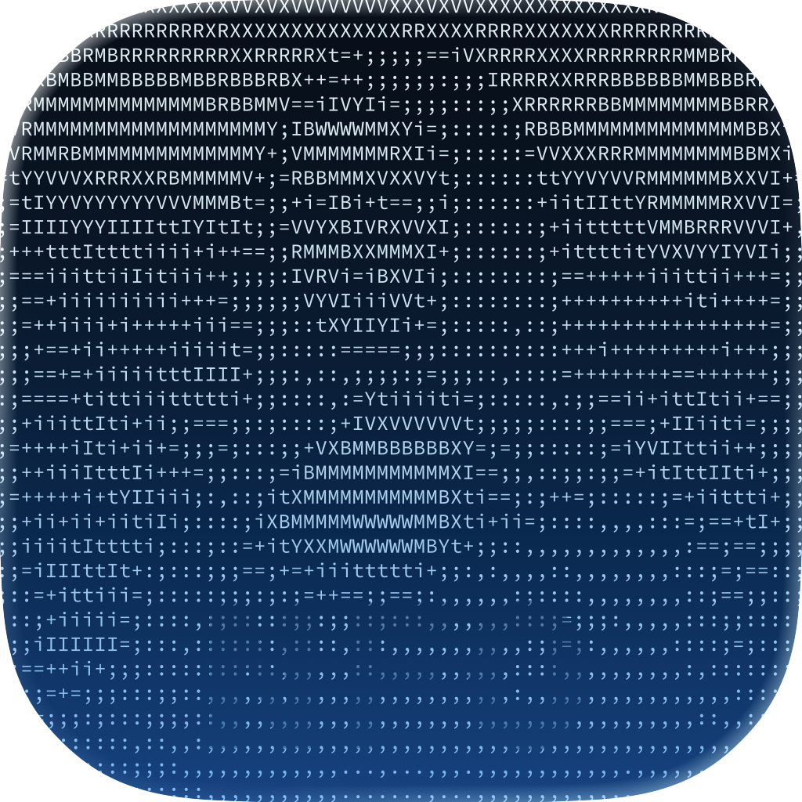
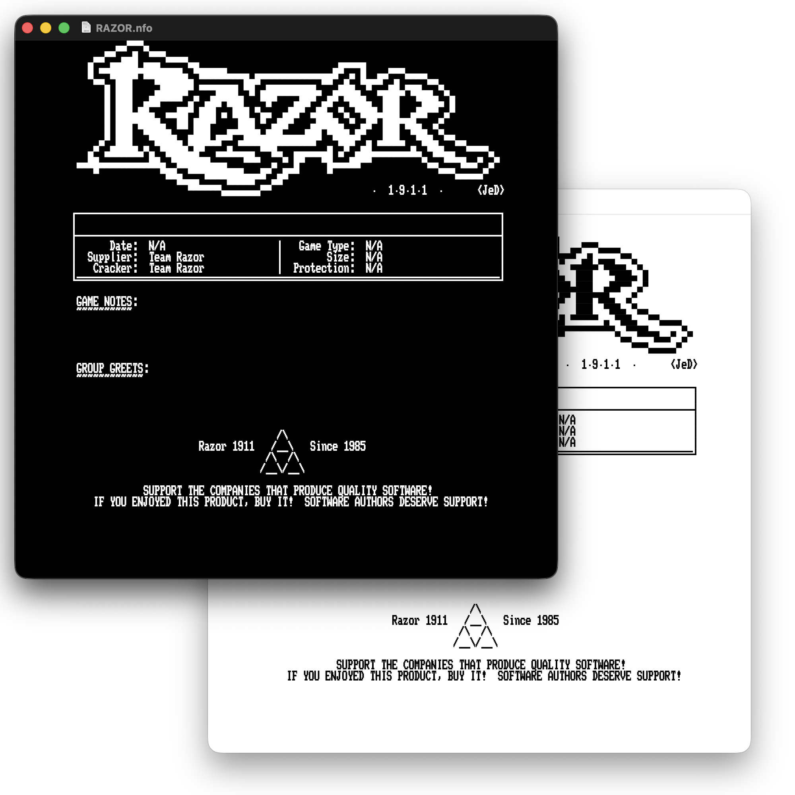
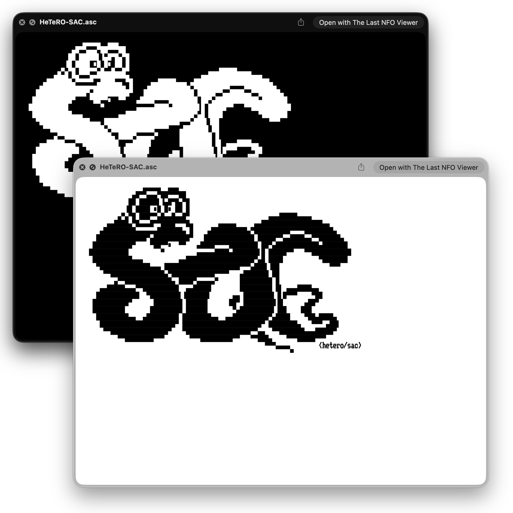

# The Last NFO Viewer

The Last NFO Viewer is a native macOS app for viewing NFO, ASC, and DIZ files. It is written in Swift and requires macOS 11 or later.

The project was inspired by [Yet Another NFO Viewer](https://github.com/mackonsti/yet-another-nfo-viewer).

## Features

- Content-aware windows that fit each document independently. Auto-fit and centered alignment are the defaults; manually resizing a window switches it to Static mode.
- Width and height limits that keep oversized documents within the display and provide scrollbars when needed.
- Finder Quick Look previews that follow the app's font, font size, colors, appearance, link highlighting, alignment, and content-fit layout.
- Automatic URL detection and clickable links.
- PNG and SVG export and copy commands.
- System, light, and dark appearances with configurable text, background, link, and selection colors.
- 29 bundled monospaced DOS and ASCII fonts, including More Perfect DOS VGA, ProFontWindows, BlockZone, Fira Code, JetBrains Mono, and Px437 variants.

Use **View > Auto-fit Window to Content** to switch sizing modes without opening Settings. Font size and appearance can also be changed from the View menu.

## Screenshots




## Settings and Quick Look

Quick Look reads the presentation settings exported by the main app to `~/.the-last-nfo-viewer.json`. Open the app once before using Quick Look, and keep the app in `/Applications` so macOS can discover its extension reliably. Setting changes are sent to active previews automatically.

If a preview does not appear or still shows an older build:

1. Replace the copy of **The Last NFO Viewer.app** in `/Applications` with the new build.
2. Open the app once.
3. Run these commands in Terminal:

   ```bash
   pluginkit -a "/Applications/The Last NFO Viewer.app/Contents/PlugIns/NFO Preview.appex"
   pluginkit -e use -i com.nle.TheLastNFOViewer.QuickLook
   killall "NFO Preview" 2>/dev/null || true
   killall QuickLookUIService 2>/dev/null || true
   qlmanage -r cache
   ```

Builds left in Xcode's DerivedData directory are not reliable installation locations for Finder extensions.

## Installation

### Homebrew

```bash
brew install NoLooseEnds/tap/the-last-nfo-viewer
```

Alternatively, add the tap first:

```bash
brew tap NoLooseEnds/tap
brew install the-last-nfo-viewer
```

### Source

See [BUILD.md](BUILD.md) for Xcode, command-line, test, and Quick Look setup instructions.

## Opening an unsigned build

The app is ad-hoc signed, so Gatekeeper may block it the first time it opens. Right-click the app, choose **Open**, then confirm. You can also allow it from **System Settings > Privacy & Security**.

If macOS reports that a downloaded copy in `/Applications` is damaged, remove its quarantine metadata:

```bash
xattr -cr "/Applications/The Last NFO Viewer.app"
```

## History

The original NFO Viewer was created by [Kris Gybels](https://blockart.sourceforge.net/index.html), followed by MacKonsti's [Yet Another NFO Viewer](https://github.com/mackonsti/yet-another-nfo-viewer), and this native Swift rewrite.

## License

See [LICENSE](LICENSE).
